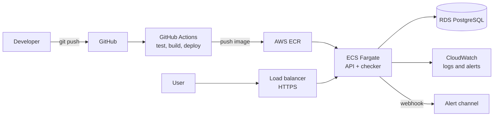

# Uptime_Monitor_Platform

> A Python uptime monitoring platform on AWS, built with Terraform, Docker and GitHub Actions CI/CD, and run like production: automated deployments, monitoring, and written-up incidents and decisions.


<!-- Once CI exists, add:

-->

---

## Why this project exists

I wanted one real project that is **deployed, broken and fixed**, not a tutorial clone. This platform watches a list of URLs, records whether they are up and how fast they respond, and alerts me when something fails.

The app is deliberately small. The point is everything around it: infrastructure as code, automated delivery, observability, and honest write-ups of what went wrong and how I fixed it.

## What it does

- Add URLs to monitor through an API
- Check each URL on a schedule and record status code and response time
- Store check history in PostgreSQL
- Send an alert after repeated failures
- Expose current status and history through the API

## Project status

I'm building this in phases and documenting every step. See the [journal](docs/journal/) for weekly progress.

- [ ] **Phase 1: App.** Checker script, FastAPI endpoints, tests, Postgres with Docker Compose
- [ ] **Phase 2: Containers and CI.** Dockerfiles, GitHub Actions for tests and image builds
- [ ] **Phase 3: AWS with Terraform.** VPC, ECR, RDS, ECS Fargate, HTTPS
- [ ] **Phase 4: Delivery and monitoring.** Deploy via GitHub Actions with OIDC, CloudWatch logs and alerts
- [ ] **Phase 5: Incidents and polish.** Deliberate failures, post-mortems, architecture diagram, demo
- [ ] **Next project: Kubernetes.** Split into services, EKS with Helm, GitOps with ArgoCD

## Architecture

> Target architecture for the AWS deployment. This will be updated as each phase lands.



## Tech stack

| Area | Choice |
|---|---|
| Language and API | Python 3.12, FastAPI |
| Database | PostgreSQL (Amazon RDS in the cloud) |
| Containers | Docker, Docker Compose |
| Infrastructure as code | Terraform |
| Cloud | AWS (ECS Fargate, RDS, ECR, ALB, Route 53, CloudWatch) |
| CI/CD | GitHub Actions with OIDC (no stored AWS keys) |
| Testing | pytest |

## Repository layout

```
Uptime_Monitor_Platform/
├── app/                 # FastAPI service and checker (split into services later)
├── infra/terraform/     # AWS infrastructure
├── .github/workflows/   # CI/CD pipelines
├── docs/
│   ├── journal/         # progress notes
│   ├── decisions/       # architecture decision records
│   └── incidents/       # post-mortems
├── docker-compose.yml
└── README.md
```

## Getting started (local)

> Instructions will be finalised once Phase 1 is complete.

```bash
git clone https://github.com/<your-username>/Uptime_Monitor_Platform.git
cd Uptime_Monitor_Platform
docker compose up --build
```

The API will be available at `http://localhost:8000`, with interactive docs at `/docs`.

## API endpoints (planned)

| Method | Path | Purpose |
|---|---|---|
| `GET` | `/healthz` | Health check for load balancers and probes |
| `POST` | `/monitors` | Add a URL to monitor |
| `GET` | `/monitors` | List monitors with current status |
| `GET` | `/monitors/{id}/history` | Recent checks for a monitor |

## Decisions

Each major choice gets its own short record, covering the context, options considered, the choice, and the trade-offs.

| # | Decision | Status |
|---|---|---|
| 0001 | Why FastAPI and PostgreSQL | Planned |
| 0002 | Why ECS Fargate before Kubernetes | Planned |

See [`docs/decisions/`](docs/decisions/).

## Incidents

I break things on purpose, then write up what happened: what broke, how I found it, how I fixed it, and what changed so it doesn't happen again.

| Date | Incident | Write-up |
|---|---|---|
| | *None yet* | |

See [`docs/incidents/`](docs/incidents/).

## Progress log

Weekly notes live in [`docs/journal/`](docs/journal/). Each entry covers what I built, what broke, what I learned, and what's next.

## Cost notes

AWS resources are created and destroyed with Terraform, and a billing alarm is set up before anything else. Monthly running cost will be tracked here once the service is live.

## Author

**Akhil Jajimoggala**: MSc Computer Science student and DevOps engineer based in London.
[LinkedIn](https://www.linkedin.com/in/akhil-jajimoggala) · [GitHub](https://github.com/Akhil-jajimoggala)

